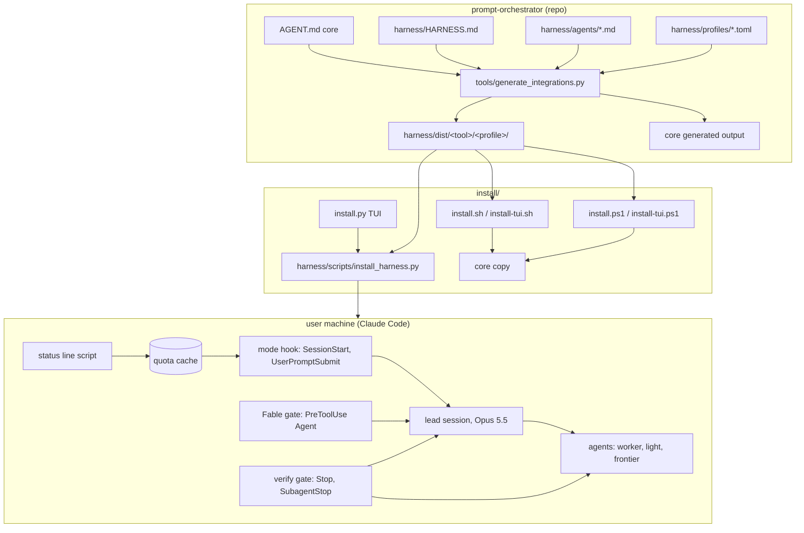

# Design Document

## Overview

The harness adds a model-aware execution layer on top of the core orchestrator. The core keeps deciding what kind of work a task is (intent, complexity, workflow). The harness decides who does it (lead or which agent), on which model (tier through profile), how widely to fan out (mode from live quota), and when work is accepted (verify gate). It ships as files under `harness/`, rendered per tool by the existing generator and installed by a new selectable installer.

Design choices that shape everything below:

- **Overlay, not edit.** `harness/HARNESS.md` supersedes `AGENT.md` sections E, F and M while installed. The core text is untouched, so removing the overlay restores core behavior.
- **Tiers in agents, models in profiles.** Agents never name a model. A profile maps tiers to models per plan, so model renames only touch one file.
- **Pre-rendered output.** The generator renders every tool and profile combination into `harness/dist/`. Installers copy files, so the native no-Python installers work too. Only Codex model discovery runs at install time, and only under Python.
- **Hooks for rules that must hold.** The Fable gate, the mode tag and the verify gate are hooks. Prompt text alone is used only on tools without hooks.
- **TOML for config.** Hook scripts read config with `tomllib` (standard library, Python 3.11+), so no third-party package is needed on the user's machine. This replaces the `.yaml` names used during the grill.

Research behind the design is in `ignore/research/harness-20261030.md` (local) and is summarized in decision records 0002 and 0003.

## Architecture



Flow of one Claude Code session:

1. SessionStart: the mode hook reads the quota cache and config, computes the mode and prints the tag.
2. The status line runs after each response and refreshes the cache.
3. UserPromptSubmit: the mode hook records a Fable command if the prompt has one, and prints a new tag only when the mode changed or a Fable command needs its quota line.
4. The lead delegates per the overlay. PreToolUse on `Agent` blocks frontier spawns without a recorded Fable command.
5. Stop and SubagentStop: the verify gate runs the repo's `verify` command when files changed.

## Components and Interfaces

### Layout

```
harness/
  HARNESS.md                 overlay, 160 lines max
  agents/<name>.md           16 canonical agents
  profiles/<name>.toml       claude-max, claude-pro, codex-plus, api, free
  critical.toml              default critical paths and keywords
  skills/autosetup.md       /autosetup skill (rendered with the agents)
  workflows/pr-sweep.js
  workflows/refactor-fanout.js
  scripts/
    harness_lib.py           config, profile, quota cache, pace, mode, state
    statusline.py            status line: cache rate_limits, display, wrap
    mode_hook.py             SessionStart and UserPromptSubmit
    fable_gate.py            PreToolUse on Agent
    verify_gate.py           Stop and SubagentStop (Claude and Codex input)
    codex_bridge.py          app-server: rateLimits and model list
    install_harness.py       per-tool install, settings merge, backup, uninstall
    render.py                agent renderers, used by the generator
  tests/test_*.py
  dist/<tool>/<profile>/...  generated
install/
  install.py                 TUI and flags (stdlib)
  install.sh, install-all.sh launchers (Python, else install-tui.sh)
  install-tui.sh             native bash TUI
  install.ps1, install-all.ps1, install-all.bat, install-tui.ps1
```

### Overlay (`HARNESS.md`)

Sections: precedence statement (supersedes E, F, M), tiers and the active profile, modes table and rules, delegation policy, Fable protocol, roster table (name, tier, use when), verification, token diet, reporting additions. It refers to agents by name and never repeats agent bodies.

### Canonical agent file

```markdown
---
name: reviewer
description: Fresh-context review of a diff or PR for correctness, security and tests; read-only; returns findings ranked by severity.
tier: worker
effort: high
access: read
omit_claude_md: true
skills: []
isolation: none          # or worktree (refactor only)
summary_limit: 400       # words the agent may return
---
<instruction body>
```

Field rules: `tier` in {frontier, lead, worker, light, inherit}; `effort` in {medium, high, xhigh}; `access` read means no Write, Edit, NotebookEdit or mutating Bash patterns. Bodies end with a fixed return contract: result, evidence (commands and output excerpts), open issues.

### Profiles

```toml
name = "claude-max"
provider = "claude"
detect = ["Max"]

[tiers]
frontier = "fable"
lead = "opus"
worker = "sonnet"
light = "haiku"

[fable]
included = true
weekly_share = 0.5          # user-stated
credits_phrase = ""         # claude-pro: "Fable with credits"

[modes]
surplus_pace = -15
conserve_pace = 10
conserve_five_hour = 75
critical = 90
fable_warn = 80
stale_minutes = 15

[fanout]
surplus = 6
normal = 4
conserve = 2
critical = 0
```

`codex-plus` adds `[effort]` per tier and is rewritten at install by discovery. `api` and `free` leave tiers empty with commented examples.

### Config files

- User: `~/.config/prompt-orchestrator/harness.toml` (Windows `%APPDATA%\prompt-orchestrator\harness.toml`): `[profiles] claude = "claude-max"`, `codex = "codex-plus"`, `plan_source` (usage-tool, codex, user, installer), `plan_set_at`, `statusline_wrap`, `fable_phrases`. Written by `/autosetup` or the installer.
- Repo: `.harness.toml`: `verify`, `verify_timeout`, `[critical] paths = [...]`, `keywords = [...]`, optional `profile`.

### Profile selection and `/autosetup`

Plans change and no local file names the plan, so hooks never detect it. Order: session override (`harness profile: <name>` in a prompt, held in session state) > repo `.harness.toml` > user config > fallback `claude-pro` or `codex-plus` with a tag line asking for `/autosetup`.

`/autosetup` is a harness skill the agent runs on request:

1. Claude: call the desktop usage tool when present; map `plan` (`Max`, `Pro`) to `claude-max` or `claude-pro`, and copy the window data to the quota cache. Codex: `account/rateLimits/read`, map `planType` (`plus`, `pro`, ...) to a profile, and refresh the Codex model mapping through `model/list`.
2. When no source answers, ask the user with options (Max, Pro, API, free) and record `plan_source = "user"`.
3. `/autosetup <profile>` skips detection.
4. Write the user config, print the tier mapping and the Fable rule for that profile.

The mode hook adds one suggestion line when `plan_set_at` is older than 30 days or the quota cache records a plan that differs from the profile.

### Runtime state

- Quota cache: `~/.cache/prompt-orchestrator/quota.json` with `ts`, `source` (statusline, usage-tool, codex), `five_hour`, `seven_day`, `fable` (optional), `plan` (optional).
- Session state: `~/.local/state/prompt-orchestrator/sessions/<session_id>.json` with `last_mode`, `fable_authorized_at`, `verify_blocks`, `verify_tree_hash`.
- Fable runs: `~/.local/state/prompt-orchestrator/fable_runs.json`, one timestamp per frontier spawn, pruned at the weekly reset.
- Windows uses `%LOCALAPPDATA%` for cache and state.

### Hook contracts (Claude Code)

| Hook | Script | Input used | Output |
|---|---|---|---|
| SessionStart | `mode_hook.py start` | `session_id` | stdout tag (added to context) |
| UserPromptSubmit | `mode_hook.py prompt` | `session_id`, `prompt` (read `user_input` as fallback) | tag only on mode change, Fable command or session profile override |
| PreToolUse `Agent\|Task` | `fable_gate.py` | `tool_input.subagent_type`, `tool_input.model` | JSON `permissionDecision: deny` with reason, or record a frontier run |
| Stop, SubagentStop | `verify_gate.py` | `session_id`, `agent_id`, `cwd`, `stop_hook_active` when present | JSON `decision: block` with failing output, or exit 0 |
| statusLine | `statusline.py` | full status JSON | one display line; writes cache |

Fable command detection: case-insensitive match of the profile's phrases ("spin up fable", "use fable", "fable with credits", "critical-architect", "critical-reviewer") in the user prompt. Authorization lasts for the session.

Mode computation (`harness_lib.mode`):

```
elapsed = 1 - (resets_at - now) / window_seconds
pace = used_percent - 100 * elapsed
if five_hour >= critical or weekly >= critical: Critical
elif weekly_pace > conserve_pace or five_hour >= conserve_five_hour: Conserve
elif weekly_pace <= surplus_pace: Surplus
else: Normal
```

Fable estimate when no usage-tool data exists: weekly % and the count of frontier runs since the last weekly reset.

### Codex bridge

`codex_bridge.py` starts `codex app-server` (JSON-RPC 2.0 over stdio), sends `initialize` with `clientInfo`, then:

- `account/rateLimits/read` (params `excludeResetCreditDetails: true`): `rateLimits.primary` and `secondary` are `RateLimitWindow` (`usedPercent`, `resetsAt`, `windowDurationMins`); `rateLimits.planType` is one of `free`, `go`, `plus`, `pro`, `prolite`, `team`, `business`, `enterprise`, `edu` and others. Cached with a 5-minute minimum interval.
- `model/list` (paged by `cursor`): each `Model` has `id`, `model`, `displayName`, `isDefault`, `hidden`, `defaultReasoningEffort`, `supportedReasoningEfforts`. Used by `/autosetup` and the installer to fill `codex-plus`.

Both methods were confirmed in the schema generated by local `codex-cli 0.156.1` on 2026-10-30. Any failure leaves the fallback mapping in place.

### Renderers

| Tool | User path | Format and fields | Model value | Effort | Read-only |
|---|---|---|---|---|---|
| Claude Code | `~/.claude/agents/<name>.md` | `name`, `description`, `model`, `effort`, `tools` or `disallowedTools`, `omitClaudeMd`, `skills`, `isolation` | alias from profile | `effort` | `disallowedTools: Write, Edit, NotebookEdit` |
| Codex | `~/.codex/agents/<name>.toml` | `name`, `description`, `developer_instructions`, `model`, `model_reasoning_effort` | model id from profile | clamped to the model's `supportedReasoningEfforts` | sentence in instructions |
| OpenCode | `~/.config/opencode/agents/<name>.md` | `description`, `mode: subagent`, `model`, `permission` (no `name`; filename is the id) | `provider/model-id` or omitted | omitted | `permission: {edit: deny, bash: deny}` |
| Cursor | `~/.cursor/agents/<name>.md` | `name`, `description`, `model`, `readonly` | `inherit` or model id | `[effort=...]` suffix only when the profile names a Cursor model | `readonly: true` |
| Copilot | `~/.copilot/agents/<name>.agent.md` | `name`, `description`, `tools`, `model` | omitted unless the profile sets one (format not documented) | omitted | `tools` without edit tools |
| Gemini CLI | `~/.gemini/agents/<name>.md` | `name`, `description`, `model`, `tools`, `max_turns` | model id or `inherit` | omitted | `tools` read set; needs `experimental.enableAgents` |
| Antigravity | `~/.gemini/config/agents/<name>.md` | `name`, `description`, `model`, `tools`, `subagent: true`, `mainAgent: false` | `inherit`, `flash` or `pro` | omitted | `tools` read set |
| Kiro | `~/.kiro/agents/<name>.md` | `name`, `description`, `model`, `tools` | model id or omitted | omitted | `tools` without `write` |

Field facts come from each tool's docs, checked on 2026-10-30 (sources in `ignore/research/harness-build-readiness.md`). Antigravity, Codex agents and Codex hooks rest on single fetches and are re-checked by reading the live page before their renderers ship. Copilot user-level agents have a reported CLI loading bug (github/copilot-cli#452), noted in the gap table. Cursor also reads `~/.claude/agents/` and `~/.codex/agents/`, so the Cursor installer item checks for duplicate names and installs Cursor files only when the user selects Cursor; the duplicate behavior is tested during the build. Every file carries the marker `prompt-orchestrator-harness`.

Codex hooks: `~/.codex/hooks.json` with `{"hooks": {"Stop": [{"hooks": [{"type": "command", "command": ..., "timeout": ...}]}]}}`; Stop input includes `stop_hook_active` and `last_assistant_message`; block with `{"decision": "block", "reason": ...}`. The verify gate reads both Claude and Codex input shapes.

### Installer

`install.py` builds a menu from a component table: tools (claude, codex, opencode, cursor, copilot, gemini, antigravity, kiro, openclaw, project) by components (core, harness), plus global items (subagent model variable, status line, hooks, legacy Kiro file). Keys: number to toggle, `a` all, `n` none, `c` core only, Enter to install, `q` to quit. Without a TTY or with `--yes` it applies defaults. It calls the existing per-tool core scripts, then `install_harness.py` per tool. `install.sh` and `install.ps1` run `install.py` when `python3` (or `py -3`) exists, else the native TUI, which offers the same items with plain numbered prompts and copies `harness/dist` files.

`install_harness.py --tool claude` steps: copy agents (skip unmarked conflicts), copy `HARNESS.md` to `~/.claude/HARNESS.md`, add `@HARNESS.md` inside the existing `prompt-orchestrator` marker block of `~/.claude/CLAUDE.md` after `@AGENTS.md`, back up `settings.json`, merge `env.CLAUDE_CODE_SUBAGENT_MODEL`, `statusLine` (wrap existing), and hook entries tagged with `statusMessage` prefix `harness:`, copy workflows, write a manifest of every change to `~/.local/state/prompt-orchestrator/install-manifest.json`. Uninstall replays the manifest in reverse.

### Session archive

`docs_scaffold.py session archive --keep N` moves older files to `sessions/history/`, writes `digest.md`, and extends chain lookup so a file's `previous:` link resolves in `sessions/` or `sessions/history/`. `session-syncer` runs archive then sync; `session-logger` runs log.

### Workflows

Claude Code loads saved workflows from `~/.claude/workflows/` (personal), `.claude/workflows/` (project) or a plugin `workflows/` directory, each a `.js` file starting with a literal `export const meta = { name, description }`. They run as `/<name>`, need Claude Code 2.1.154 or later, pause at a usage limit only on 2.1.271 or later with `autoContinueAtUsageLimit` on, and are off by default on Pro until enabled in `/config`. The harness installs to `~/.claude/workflows/`. The `agent()` option that names a subagent type or model is checked with the bundled `/workflow-authoring` skill during the build.

## Data Models

| Model | Format | Owner | Lifetime |
|---|---|---|---|
| Agent | Markdown + YAML frontmatter | repo | versioned |
| Profile | TOML | repo, Codex profile rewritten at install | versioned or per machine |
| Critical list | TOML | repo default + `.harness.toml` | versioned |
| User config | TOML | user | persistent |
| Quota cache | JSON | status line, codex bridge | replaced each refresh |
| Session state | JSON | hooks | per session, pruned after 7 days |
| Install manifest | JSON | installer | until uninstall |

## Error Handling

- Every hook script exits 0 on its own internal errors (missing config, bad JSON, timeout) and writes one line to stderr, so a broken harness never blocks work. The only deliberate exit 2 cases are a Fable spawn without authorization and a failed verify.
- Stale or missing quota data gives mode `Normal` with "stale" in the tag.
- The verify gate kills the command at the timeout and treats a timeout as a failure with a clear message.
- The settings merge refuses to write when `settings.json` is not valid JSON and reports the path.
- The Codex bridge times out after 10 seconds and leaves the previous cache.
- The installer stops on the first failed core script for a tool, reports it and continues with other tools.

## Testing Strategy

- Unit tests (`python3 -m unittest discover harness/tests`): pace and mode boundaries for each band, staleness, Fable phrase detection, gate decisions, verify gate block count and output trimming, settings merge and uninstall round trip on a temp HOME, renderer output per tool against golden files, installer flag parsing and default selection without a TTY, session archive move and chain verification.
- Validator: new checks for agents and profiles in `skills/validate_skills.py`, run as before.
- Generator: regenerate and confirm `harness/dist/` is stable on a second run.
- Shell: `bash -n` on every `.sh`; PowerShell reviewed by reading.
- Live check on this machine after install: status line writes the cache, the session start tag appears, a frontier spawn without a command is blocked, `verify` blocks on a failing command and stops after 3.

## Decisions

- **0002 Harness as an overlay**: optional layer that supersedes AGENT.md E, F, M; alternatives were two built AGENTS.md variants or conditionals in AGENT.md.
- **0003 TOML config**: stdlib `tomllib` instead of YAML so hooks need no third-party package; Python 3.11 minimum for harness scripts.
- Pre-rendering into `harness/dist/` instead of rendering at install, so native installers work without Python.
- Fable gate enforced by a PreToolUse hook rather than prompt text alone, because the user requires Fable only on command.
