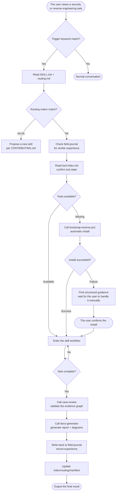
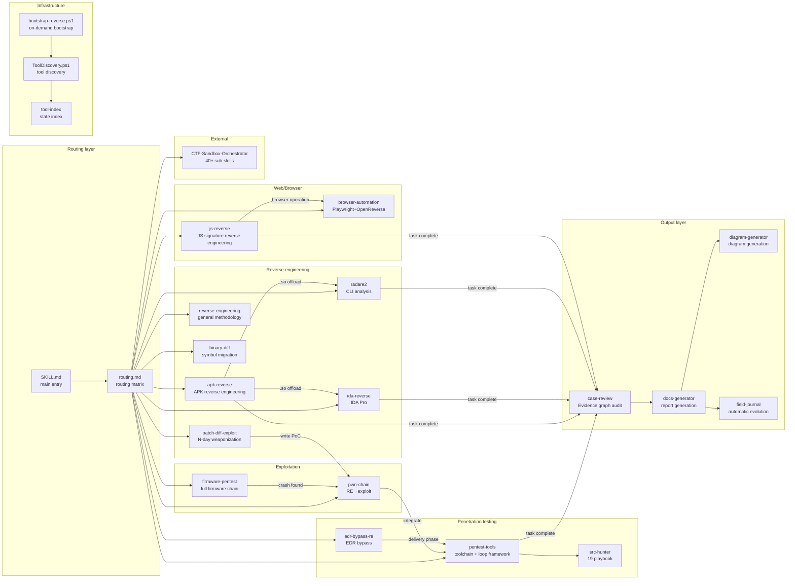
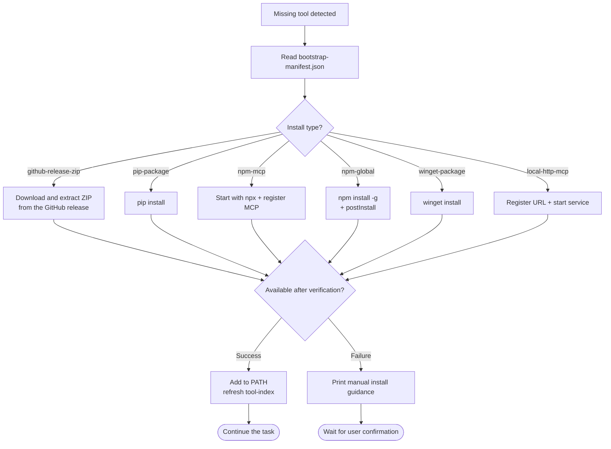
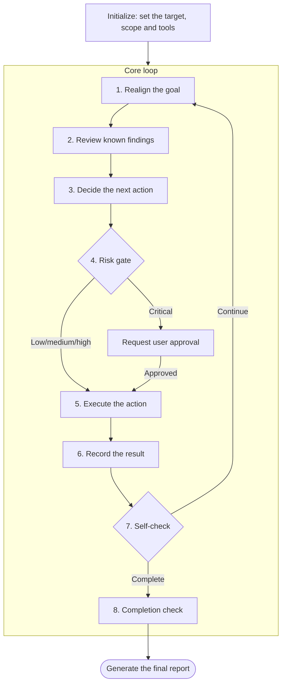
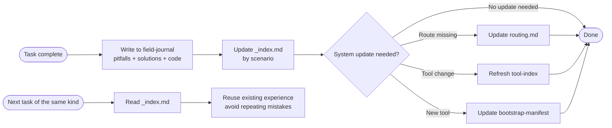
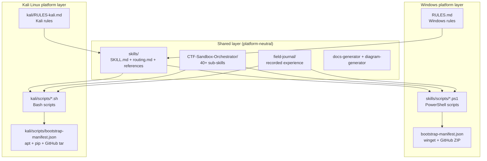
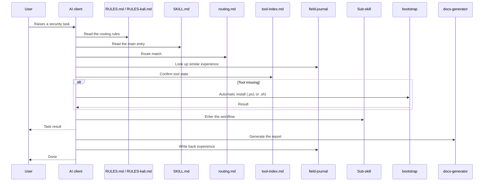

# System Architecture Diagrams

## Full behavior chain flowchart

## Skills module relationship diagram

## Bootstrap flow

## Pentest loop

## Automatic evolution mechanism

## Multi-platform support architecture

### Platform selection logic

| Environment | Rules file | Scripts | Package management |
|------|--------------|-----------|--------|
| Windows | `RULES.md` | `skills/scripts/*.ps1` | winget / GitHub Release ZIP |
| Kali Linux | `kali/RULES-kali.md` | `kali/scripts/*.sh` | apt / pip / npm / GitHub tar.gz |

### Kali edition traits

- **Many tools preinstalled**: nmap, sqlmap, hashcat, hydra, metasploit, radare2, binwalk, burpsuite and others need no bootstrap
- **Unified apt management**: no winget, no manual ZIP extraction
- **Native bash**: simpler scripts with no PowerShell dependency
- **Path conventions**: `/usr/bin/`, `/opt/`, `~/tools/`, no drive letter or space problems

## File read sequence diagram

