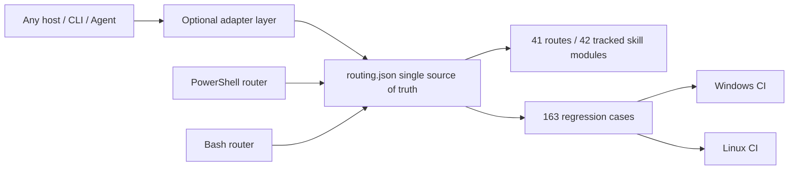

# PR #43 / #37 / #36 / #23 Local Review and Integration Report

- Date: 2026-08-08
- Baseline: `origin/main` at `6315d02`
- Review branch: `codex/review-pr-43-37-36-23`
- Scope: review only the incremental value of the four PRs relative to the current main line; no actions against external targets
- Conclusion: all four PRs have reusable value, but only #43 and #37 keep their main body; #36 and #23 must be integrated selectively

## Executive summary

| PR | Value relative to main | Integration decision | Key boundary |
|---|---|---|---|
| #43 | Very high | Keep structured routing, the 163 current regression cases, dual-platform CI, the supply chain pin gate and the dynamic index | Remove the OpenCode configuration, installer and dedicated agent; the core binds to no client |
| #37 | High | Merge case-review, evidence graph review, hash verification and unit tests, and add R40 | Accept both `done` and the current convention `completed` |
| #36 | Medium-high | Selectively merge Burp reconnect and newline message handling, atomic tokens, Anything Analyzer auth, process tree and sudo home fixes | Reject semantic regressions such as "every capability is always ready" |
| #23 | Medium (low as a whole package) | Merge only Bash case-init, case-guard, structured Bash routing and CI parity | Exclude the client inventories, GIFs, demo artifacts and hardcoded route copies among the 92 files |

## Platform boundary

The single source of truth for structured routing is `skills/config/routing.json`. The PowerShell and Bash entry points both read that file; host clients may exist only as optional adapters and cannot decide the repository identity, routing rules, test benchmark or install paths.

## Review findings and fixes

1. The design value of #43 comes from structured data and automatic gates, not from the OpenCode integration. All OpenCode-specific files and CI jobs were removed.
2. The original #37 implementation recognized only `done` and would misjudge the main line's `completed` as unfinished; compatibility and a seventh unit test were added.
3. The bridge reconnect and token writing in #36 are net gains; its capability state rewrite would create false positives and was not merged.
4. The #23 Bash router copied the hardcoded table verbatim and would drift from #43's R40/priority at once; it was rewritten to read `routing.json`, and CI checks R1/R3/R40 parity.
5. The new supply-chain gate exposed 7 floating install sources in the Kali manifest. Frida 14.10.4, the IDA MCP commit, Agent Browser 0.31.1, the ProxyCat commit, Nuclei v3.8.0 and pwntools 4.15.0 are now pinned, and the install commands actually use these pins.
6. A mandatory re-review after the push found that the Bash `case-init` did not inherit the CaseName path constraints; paths, control characters, wildcards and trailing dots or spaces are now rejected, with negative CI tests added.
7. The authorized URL in Bash once fell into `offline` by mistake and could become ready; it now matches PowerShell as `authorized_target_only`, and offline explicitly accepts only local samples.
8. The Bash `case-guard` now reads values only from the matching `auth`, `network_profile` and `signoff` sections, so fake fields in notes or evidence cannot pass the gate.
9. The pinned Kali ProxyCat source install now creates a probeable `~/.local/bin/proxycat` wrapper; the CI checkout is also pinned from a mutable tag to the v4.2.2 commit.
10. On the development machine the original dynamic INDEX wrongly included 12 local modules excluded by `.gitignore`, so a clean clone failed; the generator now enumerates only skills tracked by Git, and both a clean clone and a workspace with private extensions are stable at 42 core modules.

## Measured improvement over the old main line

The same 163 cases were run against the old hardcoded router of the main line and the new structured router, each case in a separate PowerShell process:

| Version | Passed | Accuracy | No output |
|---|---:|---:|---:|
| Old main line `6315d02` | 137 / 163 | 84.05% | 0 |
| Current structured implementation | 163 / 163 | 100% | 0 |

26 more correct routes in absolute terms, an improvement of 15.95 percentage points. The improvement covers scenarios where the old implementation fell back to R0, such as Frida/Android, certificate and root detection, packet capture replay, ransomware, Burp/Metasploit, Go binaries, BLE, USB, native `.so` and memory dumps.

## Verification results

| Check | Result |
|---|---|
| Full structured routing regression | 163 / 163 passed |
| Routing coherence and supply chain pin gate | Passed |
| PowerShell smoke | Passed |
| P0 friction / scope-guard regression | Passed |
| Old vs new 163-case A/B | 137/163 to 163/163 |
| case-review Python unit tests | 7 / 7 passed |
| Burp bridge Node regression | 1 / 1 passed |
| Bash router/case-init/case-guard parity | Passed |
| PowerShell and Bash syntax and JSON parsing | Passed |
| Java compile check | The Gradle 8.7 distribution download was blocked by the local certificate revocation network; instead, the declared dependencies from Maven Central and JDK 21 were used, and `McpHttpServer.java` compiled |

## Remaining risks

- Bash structured routing depends on Python 3; this is an explicit runtime dependency, but it avoids a second route table.
- Pinned dependency versions need periodic, explicit upgrades and no longer follow `latest` implicitly.
- Client adapters can keep growing, but the core data and tests must stay completely host-neutral.
- The Gradle task-level tests did not complete locally because the 128 MB wrapper distribution download was blocked by the certificate revocation network and a slow link; the changed Java source files were compiled independently with the same dependency versions.

## Final recommendation

Merge the selective result of the current review branch, not the original whole-package form of the four PRs. Future PRs should split into "core routing / host adapters / demo assets / documentation" so they can be reviewed and rolled back independently.
