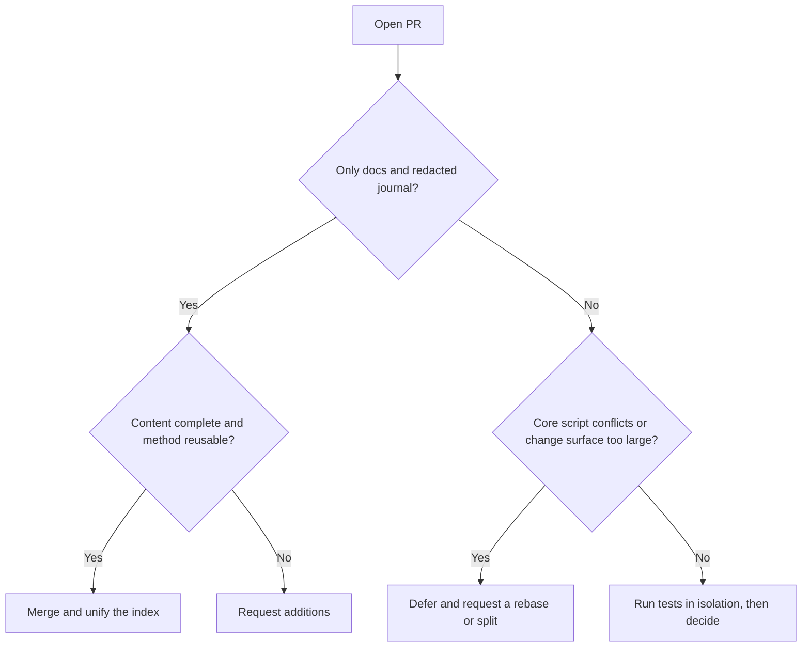

# 2026-08-08 Open PR Value Assessment and Merge Report

## Conclusion

Eight open PRs were reviewed against the latest `origin/main`. This round merges #59, #19, #22 and #29 and defers #43, #37, #36 and #23. The smoke and routing coherence checks pass after the merge.

## Assessment results

| PR | Value | Risk / state | Decision |
|---|---|---|---|
| #59 | Complete method for reproducing a Rust cdylib diff, highly reusable | Only journal and index, no executable code | Merge |
| #19 | Broad Windows 24H2 toolchain compatibility experience | Only journal and index | Merge |
| #22 | Complete Electron/Bytenode/update chain analysis method | Only journal and index | Merge |
| #29 | Complete experience with Next.js dual API serializers and contract reconstruction | Only journal and index | Merge |
| #43 | Very high value in the routing single source of truth, regression benchmark, CI and version pinning; client integration may only be an optional adapter layer | 38 files, conflicts with 4 key main-line files, the original proposal contains OpenCode-specific configuration | Defer; recommend a rebase and a dedicated review; the core must not bind to OpenCode |
| #37 | The evidence graph and case review fill a delivery audit gap | Conflicts with main-line route validation and docs | Defer; recommend a rebase and running its unit tests |
| #36 | MCP and bootstrap security hardening point the right way | 6 key file conflicts; recent main-line changes already absorbed some capabilities | Defer; deduplicate by diff |
| #23 | Bash parity and demo material have ecosystem value | 92 files, many demo assets, 2 script conflicts | Defer; recommend splitting the PR |

## Decision diagram

## Verification

- `skills/scripts/smoke.ps1`: ALL PASS (9 script parses, 8 routing cases).
- `skills/scripts/verify-routing-coherence.ps1`: ALL ROUTING COHERENCE CHECKS PASSED.
- The user's existing uncommitted journal was kept aside with stash during sync and merge and then restored.

## Follow-up recommendations

1. Have #43 rebase onto the current `main` first, focusing the review on JSON routing equivalence, the supply chain pin gate and cross-platform paths.
2. Have #37 rebase on its own and run `skills/case-review/tests/test_review_case.py`.
3. Compare #36 file by file with the merged security fixes and extract only tests or boundary handling not yet covered.
4. Split #23 into three independent PRs: Bash parity, plugin metadata and demo assets.
